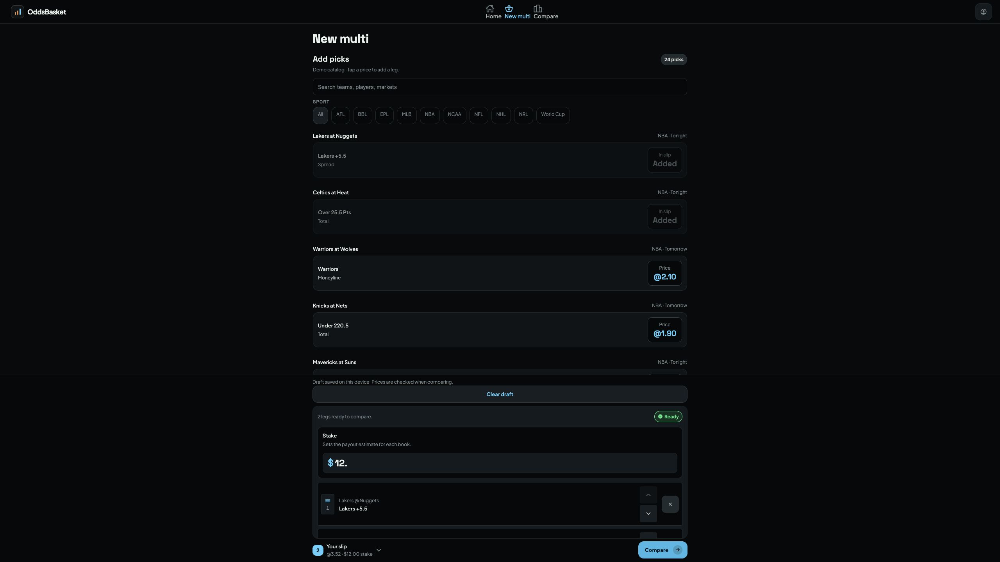
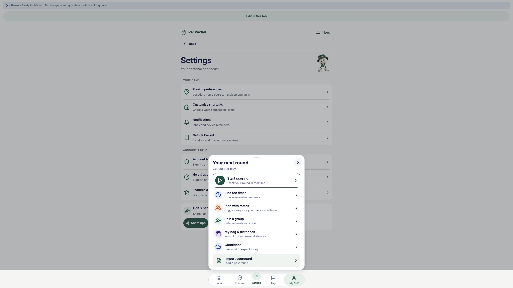

# Real consumer browser QA — 29 October 2026

Tested local static builds through the in-app browser. These checks used disposable local demo state, not production accounts or transactions.

## OddsBasket

Build: final `npm run verify:full` output on branch `task/blueprint-product-workflows`; 259 tests passed. Served on `127.0.0.1:8772`.

1. Selected two demo catalog entries and entered raw stake text `12.`.
2. Observed the saved acknowledgment, reloaded and expanded the slip: both entries and the exact raw input survived.
3. Compared the draft: the comparison page showed the $12 stake and explicit demo-price labeling. Returned with browser Back; input remained `12.`. Repeated comparison and Back successfully.
4. Cleared the draft through the visible control: default stake returned, selections emptied and Compare became disabled. Reload retained the cleared state.
5. Opened the screenshot-upload route and verified its capture/check/compare entry state. No real screenshot, OCR provider or external sportsbook was used.

## Golf App

Build: isolated `codex/blueprint-capability-adoption` worktree, physical `npm ci`, repository `qa:with-export` wrapper. Served on `127.0.0.1:8771`.

1. Opened Settings and Account & data. Guest/account availability and backup/restore controls rendered.
2. Opened quick actions: focus moved into the sheet. Closed with the visible close button: the accessibility tree confirmed focus returned to Actions.
3. The feedback route remained unavailable under the existing localhost eligibility policy. Its new draft/submission behavior is covered by component tests; browser end-to-end feedback submission is not claimed.
4. The local writer-lease banner subsequently put the tab into browsing mode; it was preserved, not bypassed. No saved golf data was replaced and no backup file was imported in this browser session.

## Scope

Final screenshots use the browser's normal desktop viewport. An attempted viewport override produced a dimension mismatch and was reset; this run makes no mobile-viewport or native-device acceptance claim. The app-specific tests cover storage failures, delayed saves, stale extraction, account ownership and backup commit receipts beyond this browser smoke check.

Temporary tabs, servers and owned Golf QA export are cleaned up after evidence capture. Screenshots are retained here. Native file-provider restoration, real account switching, crash/analytics delivery and OTA remain separate acceptance work.
